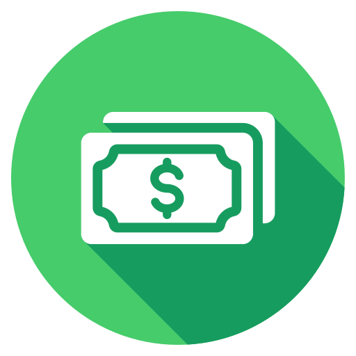
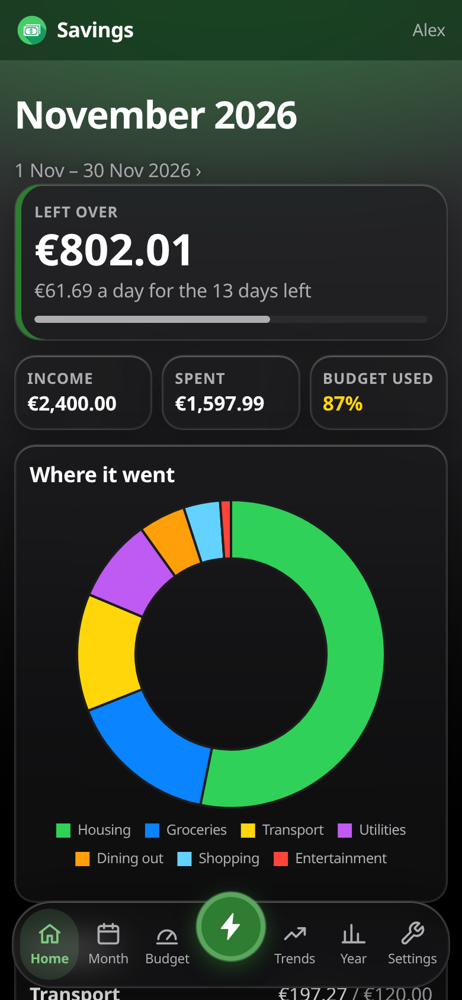
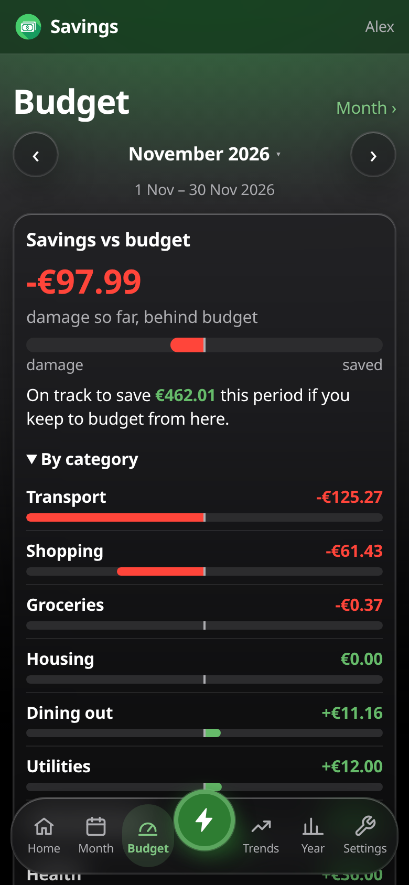
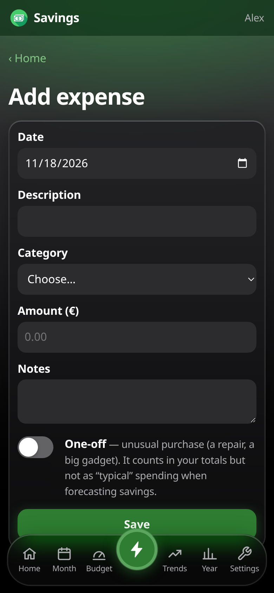
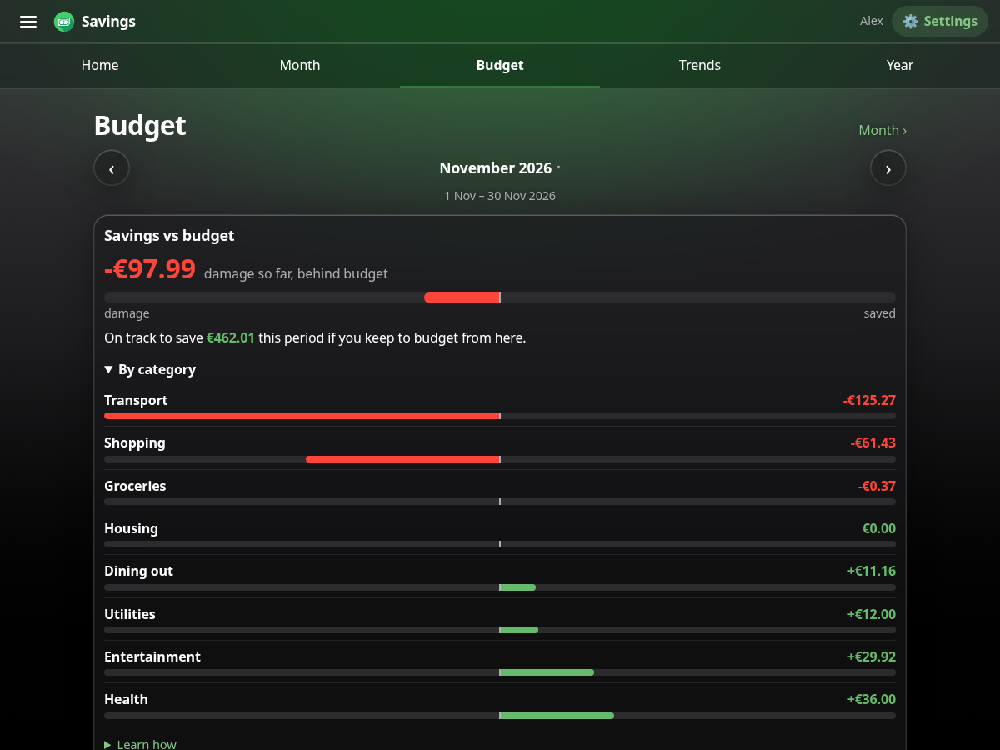

  

<h1 align="center">Savings</h1>

<strong>The free, self-hosted spending tracker.</strong>

  
  
  
  

Savings is a small spending tracker you run on your own PC or home server. You log what you spend
and earn by hand, from your phone or computer. It shows what's left this month, how you're doing
against your budgets, where the money went and when you can afford what you're saving for.
**Your data stays in one folder on your own machine**: no cloud, no bank logins, no ads, no
tracking.

  
  
  

  

> **Keep it on your own network.** Savings is meant for your home network or a VPN. Logins are
> protected (hashed passwords, cross-site request blocking, login throttling), but it uses plain
> HTTP, so don't expose it to the internet or forward its port on your router. See
> [SECURITY.md](SECURITY.md).

## What it does

- **Home:** what's left this period, a day-by-day allowance, where the money went, your budgets
  and the last six months at a glance.
- **Budget:** how far ahead (*saved*) or behind (*damage*) your budgets you are right now, per
  category, with a day-by-day pace chart and a track record.
- **Month, Year and Trends:** every category and period, your savings rate, what changed, and your
  spending pace against your usual.
- **Planned purchases:** a transparent forecast of when you can comfortably afford something.
- **Everyday helpers:** recurring expenses, quick add on the phone, CSV import and export, shared
  categories for households, budget periods that start on your payday.
- **Accounts for the household**, approved in a separate admin app that only works on the PC
  running Savings.
- **Daily backups** you can restore, and the activity log in the admin app shows each one.
- **Looks:** Light, Dark, and iOS-style **Glass** and **Glass Dark** themes; works full screen as
  an app on your phone's home screen.
- **KDE Plasma widget** (optional) showing what's left in your panel, released separately.

## Want to get started?

1. Get the latest `savings-X.Y.Z.tar.gz` from the **Releases** page.
2. Unpack it and run `./install.sh`. You need Linux with Docker; the installer asks a few
   questions and sets everything up. Its `INSTALL.md` walks you through it.
3. Open the admin app, create the admin login, then request your account in Savings and approve it.

Details: [Installing and running](docs/install.md).

**On KDE Plasma?** Get `savings-widget-X.Y.Z.tar.gz` too and run its `./install.sh`. The widget
has its own releases, so it can be updated without reinstalling Savings. See
[KDE Plasma widget](docs/widget.md).

## Documentation

| | |
|---|---|
| [Installing and running](docs/install.md) | install, start at boot, the `savings` command, settings |
| [Using Savings](docs/using-savings.md) | budget periods, categories, the phone, recurring expenses, import and export |
| [Accounts and the admin app](docs/accounts-and-admin.md) | accounts, the admin app, security notes |
| [Shared categories](docs/shared-categories.md) | sharing costs within a household |
| [Trends and Budget](docs/trends-and-budget.md) | you against your past, and against your plan |
| [Planned purchases and the forecast](docs/forecast.md) | how the forecast works, with a worked example |
| [Themes and appearance](docs/appearance.md) | themes, per-device settings, animations |
| [KDE Plasma widget](docs/widget.md) | the panel widget |
| [Backups and restore](docs/backups-and-restore.md) | what's backed up and how to restore it |

What changed in each version: [CHANGELOG.md](CHANGELOG.md).

## Something not working right?

Open an issue on the **Issues** page with what you did, what you expected and what happened.
Mention your Savings version (it's on the admin app's home page). For anything security-related,
follow [SECURITY.md](SECURITY.md) instead.

## Want to contribute?

Ideas, bug reports and pull requests are welcome. [CONTRIBUTING.md](CONTRIBUTING.md) explains how
to run a test copy, run the tests and write a changelog entry. Please follow the
[code of conduct](CODE_OF_CONDUCT.md).

## Development

Savings is a [FastAPI](https://fastapi.tiangolo.com/) app with server-rendered pages, plain CSS
and SQLite, running in Docker. The KDE widget is QML in [`widget/`](widget/).

- [Development](docs/development.md): run a test copy, the tests, the project layout.

## About this project

Savings is built with AI assistance: its code, tests and documentation were written with
Anthropic's Claude (through Claude Code), directed, reviewed and tested by its maintainer. Every
release passes the full automated test suite (over 600 tests) before it's packaged, and every
change is recorded in the [changelog](CHANGELOG.md).

## License

[MIT](LICENSE). Free to use, change and share.
